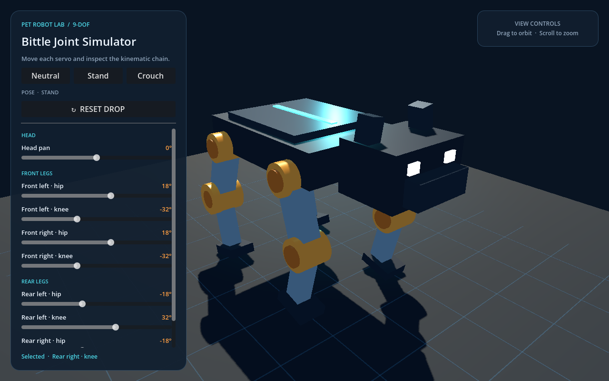

# Bittle Joint Simulator

A compact Godot 4 scene for exploring the nine articulated joints of a Bittle-style quadruped robot.

## Run

Open the project in Godot 4 and run the main scene, or start it from the repository root with `godot --path .`.

## Controls

- Use the on-screen sliders to rotate the head, hip, and knee servos.
- Choose **Neutral**, **Stand**, or **Crouch** for quick pose presets.
- Press **Reset Drop** to place the rigid robot above the floor and release it under gravity.
- Drag the empty 3D view to orbit the camera.
- Scroll over the 3D view to zoom.

The visualization is built entirely from Godot primitive meshes. The robot uses a `RigidBody3D` with synchronized compound colliders, and the floor uses a static collider.
